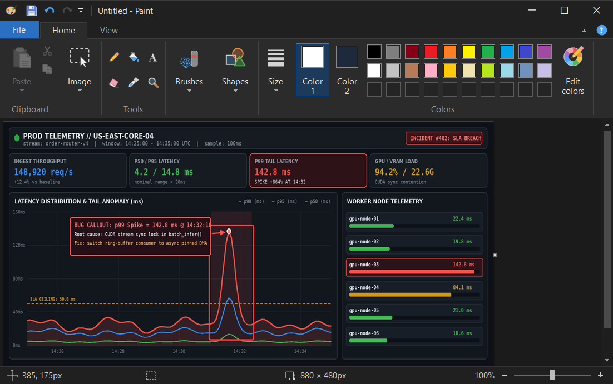

# Legacy Paint — Dark Mode


> **🎨🖌️ Windows 10 - Legacy Paint Dark Mode ⚡ Full replacement.**

<p align="center">
  <picture></picture>
</p>

A faithful, fast dark-mode recreation of classic Windows Paint (`mspaint.exe`) for Windows 10 and Windows 11. Every ribbon tab, tool gallery, modal dialog, ruler, status bar, and workspace surface is rendered in native dark chrome — with an optional dark starting canvas toggleable directly from the **View** tab.

---

## Quick Start

### Option 1 — PowerShell One-Liner *(Recommended)*

Paste and run in PowerShell to clone into a temporary folder, build, launch the setup prompt, and automatically clean up the temporary source clone when finished:

```powershell
$d="$env:TEMP\PaintDark"; Remove-Item $d -Recurse -Force -EA 0; try { git clone https://github.com/1nstntKaRma/Legacy-Paint-Dark-Mode.git $d; powershell -ExecutionPolicy Bypass -File "$d\build.ps1" } finally { Remove-Item $d -Recurse -Force -EA 0 }; exit
```

If no local `.NET SDK` compiler is detected on a stock Windows 10 system, `build.ps1` prompts:

| Choice | Action |
|---|---|
| **`[1] Compile Locally`** | Downloads Microsoft's official Roslyn compiler (`~25 MB` in temp, with `winget` as fallback) and compiles from source (default). |
| **`[2] Use Pre-built`** | Downloads the pre-built release executable directly from GitHub Releases. |
| **`[3] Cancel`** | Exits without downloading or changing anything. |

Once `bin\PaintDark.exe` is ready, the script prompts (`Choice:`):

| Choice | Action |
|---|---|
| **`[1] Apply Dark Mode`** | Right-click *"Edit"* @ image files (`.png`, `.jpg`, `.bmp`, `.gif`, `.tif`, `.webp`, `.ico`) will use Paint - Dark Mode (`%LOCALAPPDATA%\PaintDark\PaintDark.exe`), and *"Edit with Paint 3D"* is hidden (default). |
| **`[2] Revert`** | Restores the original Windows Paint (`mspaint.exe`) for `Right-click -> Edit` and removes the per-user install copy. |
| **`[3] Cancel`** | Exits without changing anything (`bin\PaintDark.exe` stays ready to run standalone). |

#### Non-Interactive Flags

```powershell
.\build.ps1 -Shell Apply            # Build, install to %LOCALAPPDATA%\PaintDark, and register Right-click -> Edit
.\build.ps1 -Shell Revert           # Restore original Windows Paint
.\build.ps1 -Shell Cancel           # Build only, skip registry changes
.\build.ps1 -NoBuild -Shell Clean   # Full cleanup: restore Windows defaults and remove settings
.\build.ps1 -Launch                 # Launch PaintDark.exe after building
```

### Option 2 — Download Pre-Built Release

1. Download **`PaintDark-v1.4.zip`** from **[Releases](https://github.com/1nstntKaRma/Legacy-Paint-Dark-Mode/releases/latest)** and extract it (or download **`PaintDark.exe`** to run standalone with zero setup).
2. Double-click **`Activate Paint Dark Mode.cmd`** (or run `build.ps1` and choose **`[1] Apply Dark Mode`**) to set Legacy Paint Dark Mode as your default editor for `Right-click -> Edit` @ image files in File Explorer (while hiding *"Edit with Paint 3D"*).
3. To restore the original Windows Paint at any time, double-click **`Revert to Windows Paint.cmd`** (or choose **`[2] Revert`** in `build.ps1`).

**Target OS:** Developed and tested on **Windows 10 22H2 (Build 19045)**. Also works on Windows 11.

---

## Highlights

- **100% Native Dark Chrome:** Custom-drawn dark title bar, Quick Access Toolbar, **File** backstage menu, **Home** and **View** ribbon tabs, dropdown galleries, scrollbars, rulers, status bar, and modal dialogs (**Resize and Skew**, **Image Properties**, **Edit Colors**, **Page Setup**).
- **Dark or Light Starting Canvas:** New documents start on a black canvas (`#000000`) with white (`#FFFFFF`) as Color 1 by default — toggle **View -> Dark canvas** anytime to switch between black and classic white backgrounds.
- **Complete Classic Toolset:**
  - **9 Brushes:** Brush, Calligraphy 1 & 2, Airbrush, Oil, Crayon, Marker, Natural Pencil, and Watercolor with anti-aliased pressure/bristle rendering.
  - **23 Live-Editable Shapes:** Lines, multi-point curves, polygons, rectangles, callouts, arrows, stars, heart, and lightning bolt — all resizable and style-adjustable until committed.
  - **Rich Text Tool:** Contextual **Text** ribbon tab, live font/size preview, Opaque/Transparent background modes, and full bidirectional (RTL / Hebrew) + IME composition support.
  - **Pixel-Precise Editing:** Rectangular & free-form selection with **Transparent selection**, **Crop**, **Resize and Skew** (percentage or pixels), **Rotate / Flip**, **Invert color**, and **1px Pixel Gridlines + Rulers** up to `800%` zoom.
- **Fast & Lightweight:** Single ~420 KB native executable built on .NET Framework 4.8 with a 32-bpp ARGB `DIBSection` surface, integer mipmap zoom pyramid, and 50-step delta-compressed Undo/Redo history.

---

## Keyboard Shortcuts

| Shortcut | Action | Shortcut | Action |
|---|---|---|---|
| `Ctrl+N` / `Ctrl+O` / `Ctrl+S` | New / Open / Save | `Ctrl+Z` / `Ctrl+Y` | Undo / Redo (up to 50 steps) |
| `F12` | Save As | `Ctrl+A` / `Delete` | Select All / Delete Selection |
| `Ctrl+W` | Resize and Skew | `Ctrl+Shift+X` | Crop to Selection |
| `Ctrl+E` | Image Properties | `Ctrl+Shift+I` | Invert Colors |
| `Ctrl+R` / `Ctrl+G` | Toggle Rulers / Gridlines | `Ctrl+PageUp` / `Ctrl+PageDown` | Zoom In / Zoom Out |
| `F11` | Full Screen View | `Ctrl+ Plus` / `Ctrl+ Minus` | Step Tool / Line Width |

---

## License

Released under the [MIT License](LICENSE).
