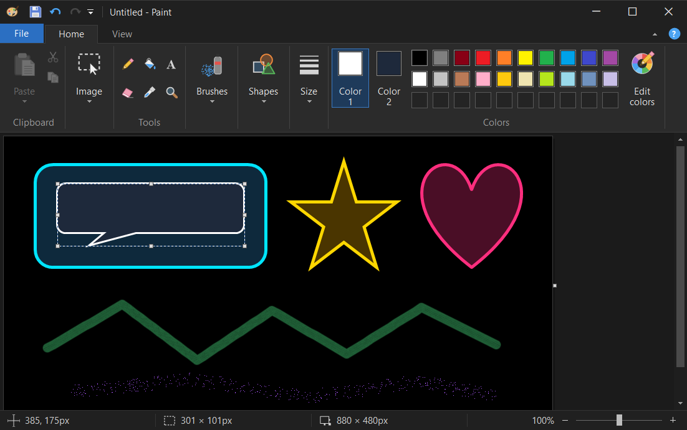
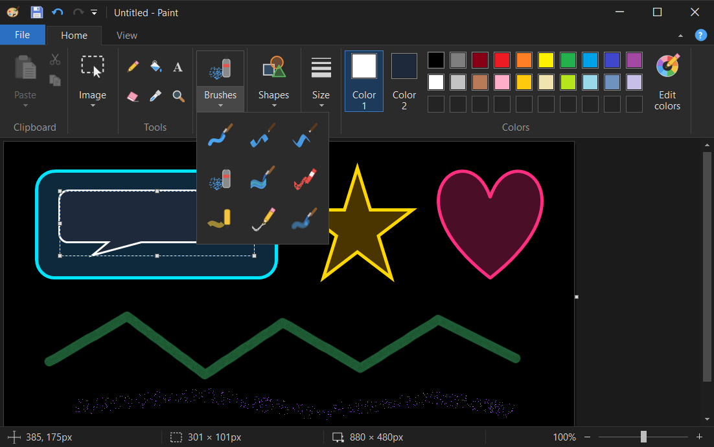
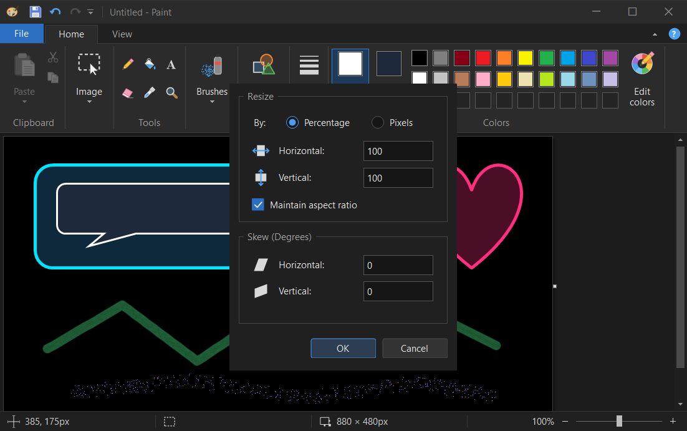

# Legacy Paint - Dark Mode

> **A full dark-mode recreation of classic Windows Paint (`mspaint`) for Windows 10/11: same features, same layout, zero white.**


-512BD4)


**Legacy Paint – Dark Mode** is a standalone Windows application that looks and works like the classic ribbon Paint (`mspaint.exe`) from Windows 7 and Windows 10, but is **100% dark**—including the title bar, Quick Access Toolbar, ribbon, galleries, menus, modal dialogs, canvas workspace, and status bar.

It is a single **~420 KB `.exe`** with nothing extra to install, because it runs on **.NET Framework 4.8**, which is built into every Windows 10 and Windows 11 installation.

---

## Screenshots

### Dark Ribbon & Dark Canvas


### Classic Brush & Tool Galleries


### Fully Dark Dialogs (Resize and Skew)


---

## Use Case

Built for anyone who loves the fast, simple classic Windows Paint workflow—for quick edits, screenshots, annotations, and pixel work—but hates its blinding white interface, which Microsoft never gave a dark mode in Windows 10.

- **Zero white flash:** Dark custom window frame, ribbon, popups, dialogs, and an optional **Dark canvas** mode where new pictures start black (with white selected as Color 1).
- **Optional Explorer integration:** Can replace `Right-click -> Edit` on pictures (and hide *"Edit with Paint 3D"*), while **Revert** puts the original Windows Paint back in one click. Everything is written per-user (`HKCU\Software\Classes`), requiring **no administrator privileges**.

---

## Download & Quick Start

### Option 1: Download Pre-Built Executable (No SDK Required)

1. Go to **[Releases](https://github.com/1nstntKaRma/Legacy-Paint-Dark-Mode/releases/latest)**:
   - Download **`PaintDark.exe`** (~420 KB) to run it immediately as a standalone portable app (double-click it, drag-and-drop an image onto it, or pass a file path on the command line).
   - Or download **`PaintDark-v1.3.zip`** (which includes `bin\PaintDark.exe` and `build.ps1`) and run `.\build.ps1 -NoBuild -Shell Yes` in PowerShell if you also want `Right-click -> Edit` on pictures in Explorer to open Legacy Paint – Dark Mode.

> **Note on Windows SmartScreen / Unsigned Binaries:** `PaintDark.exe` is not signed with a commercial Authenticode certificate, so Windows SmartScreen or some antivirus tools may show an *"Windows protected your PC"* prompt on first download (*More info* -> *Run anyway*). If you prefer not to run a downloaded executable, you can compile it from source in ~2 seconds using Option 2 below.

### Option 2: Build from Source

```powershell
git clone https://github.com/1nstntKaRma/Legacy-Paint-Dark-Mode.git
cd Legacy-Paint-Dark-Mode
.\build.ps1
```

Building requires any installed **.NET SDK** (used only for its C# compiler `csc.dll`; the compiled executable targets `.NET Framework 4.8`).

> **Note for automated / non-interactive builds:** Running `.\build.ps1` interactively prompts after compiling to ask about Explorer right-click integration (`Yes` / `Revert` / `No`). To build without any prompt, run:
> ```powershell
> .\build.ps1 -Shell No
> ```

---

## Features

- **Window & Chrome:** Dark custom caption with customizable Quick Access Toolbar (can sit above or below the Ribbon), native window snapping, Windows 11 snap layouts, and per-monitor DPI scaling (`PerMonitorV2`).
- **Ribbon:** *Home* / *View* / contextual *Text Tools* / *Print preview* tabs, split buttons, dropdowns, galleries, original Paint tooltip wording, `Alt` / `F10` key tips, `Ctrl+F1` ribbon minimize, and responsive group collapsing when the window is narrow.
- **File Menu:** *New*, *Open*, *Save*, *Save as* (PNG / JPEG / BMP / GIF / Other formats), *Print* / *Page setup* / *Print preview*, *From scanner or camera* (WIA), *Send in email* (MAPI), *Set as desktop background* (Fill / Tile / Center), *Properties*, *About*, *Exit*, plus *Recent pictures* with pinning.
- **Tools:** Pencil, Fill bucket, **Text** (rich text via the same windowless RichEdit engine classic Paint uses, with per-selection font, size, Bold/Italic/Underline/Strikethrough, foreground/background colors, **full RTL / Hebrew**, and IME support), Eraser (right-click erases Color 1 only), Color picker (eyedropper), Magnifier.
- **Brushes (all 9):** Brush, Calligraphy brush 1, Calligraphy brush 2, Airbrush, Oil brush, Crayon, Marker, Natural pencil, Watercolor brush.
- **Shapes (all 23):** Line, Curve (two-bend), Oval, Rectangle, Rounded rectangle, Polygon, triangles, arrows, stars, callouts, Heart, and Lightning. Shapes remain live-editable after drawing (move, resize, recolor, adjust outline width) and support Solid, Crayon, Marker, Oil, Natural pencil, and Watercolor outlines and fills.
- **Selection:** Rectangular and Free-form selection, *Select all*, *Invert selection*, *Delete*, and *Transparent selection*. Moving leaves Color 2 behind, `Ctrl+drag` copies, `Shift+drag` stamps a trail, arrow keys nudge by pixel, and handles stretch/resize the selection.
- **Image Operations:** *Crop*, *Resize and Skew* (percentage or pixels, aspect ratio lock, horizontal/vertical skew in degrees), *Rotate / Flip* (90° right/left, 180°, vertical/horizontal flip), *Invert color*, and interactive canvas resize grips.
- **View & Dark Canvas:** Zoom `12.5%`–`800%` (slider, buttons, `Ctrl+Mouse Wheel`), rulers, gridlines, status bar, *Thumbnail* window, *Full screen* (`F11`), and **Dark canvas** (new pictures start black with white as Color 1; toggle it off on the *View* tab anytime for a classic white canvas).
- **File Formats:** Opens `BMP`, `JPEG`, `GIF`, `TIFF`, `PNG`, and `ICO` (plus `HEIC`, `WebP`, and `JXR` when the Windows codecs are installed). Saves `PNG`, `JPEG`, `BMP` (1/4/8/24-bit), `GIF`, and `TIFF` (preserving transparency in PNG and TIFF).
- **Undo & Crash Recovery:** 50 levels of compressed, memory-capped undo/redo. Settings are saved in `%APPDATA%\PaintDark\settings.ini`, and if an unexpected error ever occurs, any unsaved picture is automatically written to `%APPDATA%\PaintDark\Recovered\`.

---

## Explorer Right-Click Menu Integration

After building (or when called with `-NoBuild`), `build.ps1` offers to configure Windows Explorer's right-click menu for image files:

| Choice | Command | `"Edit"` on pictures opens | `"Edit with Paint 3D"` |
|---|---|---|---|
| **Yes** | `.\build.ps1 -NoBuild -Shell Yes` | Legacy Paint – Dark Mode (`PaintDark.exe`) | Hidden |
| **Revert** | `.\build.ps1 -NoBuild -Shell Revert` | Original Windows Paint (`mspaint.exe`) | Hidden |
| **No** | `.\build.ps1 -NoBuild -Shell No` | Unchanged | Unchanged |
| **Clean** | `.\build.ps1 -NoBuild -Shell Clean` | Restores all Windows factory defaults | Restored |

All changes are written strictly to the current user's registry hive (`HKCU\Software\Classes`), which Windows merges over `HKLM\Software\Classes`. **No administrator rights are needed**, nothing system-wide is modified, and every key created by the script is tagged with a `PaintDarkMode` marker so `Revert` and `Clean` never touch settings owned by you or other apps.

On Windows 11, classic context-menu verbs like *Edit* appear under *Show more options* (`Shift+F10`).

---

## Compatibility

- **Tested on:** Windows 10 (22H2, 64-bit).
- **Also compatible with:** Windows 11 (64-bit), using the built-in `.NET Framework 4.8` runtime.

---

## Testing Hook

`PaintDark.exe --test-hook` accepts scripted commands over `WM_COPYDATA` for automated UI testing and off-screen `WM_PRINTCLIENT` screenshots without touching the physical mouse, keyboard, or window focus. The hook is completely disabled unless `--test-hook` is passed on the command line.

---

## License & Disclaimer

Licensed under the [MIT License](LICENSE).

**Disclaimer:** This is an independent open-source project and is not affiliated with, endorsed by, or sponsored by Microsoft Corporation. *"Paint"*, *"mspaint"*, and *"Windows"* are registered trademarks of Microsoft Corporation. All icons, brushes, and UI rendering in this repository are original code, with no Microsoft binaries or assets copied.